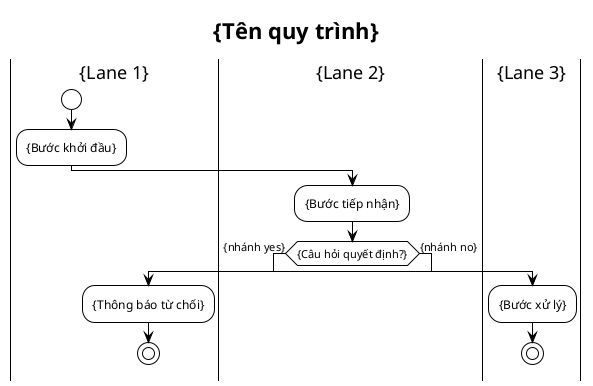

# /activity-swimlane — Activity Diagram với Swimlane thật (PlantUML)

> Họ diagram activity 3 lựa chọn: `/activity` (Mermaid, nhúng inline auto-render GitHub/Obsidian) · `/d2-activity` (D2+ELK, hình đẹp standalone) · `/activity-swimlane` (PlantUML, **swimlane thật** cho luồng đa-vai-trò nhiều cross-lane). Cần chuẩn OMG import Camunda → `/bpmn`.

## Goal

Vẽ 1 quy trình nghiệp vụ đa vai trò thành activity diagram có **swimlane thật** bằng [PlantUML](https://plantuml.com) `|Lane|` syntax: mỗi vai trò 1 lane thẳng cột cố định, node "nhảy" sang lane của actor chịu trách nhiệm, decision hình lục giác chuẩn UML. Render qua plantuml.com (không cần Java local).

**Tại sao cần skill này bên cạnh `/activity` + `/d2-activity`:** luồng đa-vai-trò nhiều tương tác qua lại (vd refund: Khách ↔ Hệ thống ↔ Agent ↔ Quản lý liên tục) làm **Mermaid subgraph** xô lệch và **D2/ELK** kéo lane ra xa nhét đường thành "mì Ý". PlantUML `|Lane|` giữ lane thẳng cột **cố định**, layout engine chuyên biệt cho swimlane.

**Output:**
1. Source + ảnh trong `srs/`: `docs/{feature}/srs/{feature}-{slug}-swimlane.puml` + `.svg`.
2. Section nhúng ảnh trong `srs/{feature}-flows.md`: `## Flow: {title} (Swimlane)` chứa `` + Trigger/Related.

## Constraints

- **Output cố định**: `.puml` + `.svg` trong `srs/`, section nhúng ảnh trong `srs/{feature}-flows.md`.
- **Render qua plantuml.com**: Dùng script `render.py` hoặc `render.sh` trong thư mục skill. Lưu ý nội dung tên bước gửi qua internet tới plantuml.com.
- **AI viết source .puml, KHÔNG tự tính toạ độ**: PlantUML layout engine tự căn chỉnh.
- **Compile phải PASS**: Script render phải trả về SVG hợp lệ (>200 bytes, không có syntax error).
- **L1 approval trước Write**: BẮT BUỘC in bảng kế hoạch BA-friendly và dừng chờ người dùng phê duyệt trước khi ghi file.
- **KHÔNG L3 iterate**: PlantUML không render trong chat; review qua file render.
- **Vietnamese-first**: Labels tiếng Việt, cú pháp English.
- **Idempotent**: Trùng slug tự vào update mode (L2 diff).

## Công thức chuẩn

1. **Swimlane theo vai trò**: Mỗi role 1 lane `|Tên lane|`.
2. **Start rõ ràng** (`start`) + **mọi nhánh có end** (`stop` hoặc `end`) — không nhánh cụt (no loose ends).
3. **Decision yes/no**: `if (...) then (...) else (...) endif` tại điểm rẽ.
4. **Tương tác giữa lane**: Đổi lane bằng `|Lane khác|` ngay trước bước activity tương ứng.
5. **TRÁNH dấu ngoặc kép `"..."`**: Không dùng quote bọc label activity trong PlantUML.
6. **Theme sạch**: Khai báo `!theme plain` ở đầu file.

## Cách gọi (Inputs)

```
/activity-swimlane "<mô tả quy trình>" --feature <slug>     # tạo mới
/activity-swimlane --feature <slug>                          # interactive: hỏi quy trình nào
/activity-swimlane "<mô tả quy trình của feature mới>"        # feature chưa có → derive slug + phỏng vấn + tạo
```

## Context (dynamic)

- Ngày làm việc hiện tại
- Python/python3 và kết nối internet tới plantuml.com
- Features có sẵn trong `docs/`

## Runtime Flow

1. **Resolve feature + process slug**: kebab-case từ mô tả (max 40 ký tự).
2. **Đọc nguồn nghiệp vụ**: Đọc spec/UC/flows đã có, hoặc phỏng vấn nhanh đúng phạm vi (bước tuần tự, điểm quyết định, lanes, retry loop).
3. **Xác nhận lanes trước khi vẽ**: In danh sách vai trò phát hiện được và chờ người dùng xác nhận đủ/thiếu.
4. **Trích fact-list**: Lanes, decision points, outcome mỗi nhánh phải tới điểm kết thúc.
5. **Viết source .puml**: Tuân thủ quy tắc `|Lane|` đặt ngay trước activity.
6. **L1 plan preview (BẮT BUỘC DỪNG XÁC NHẬN)**: In tóm tắt kế hoạch (K lanes, N bước, M decisions) và chờ người dùng xác nhận.
7. **Write .puml & Render**:
   - Chạy: `python .agents/skills/activity-swimlane/render.py docs/{feature}/srs/{feature}-{slug}-swimlane.puml` (hoặc `bash .agents/skills/activity-swimlane/render.sh ...`)
   - Tự sửa tối đa 2 lần nếu compile fail.
8. **Append section vào flows.md**: Nhúng ảnh `` kèm metadata Trigger/Related UC/FR.
9. **Coverage verify**: Kiểm tra mọi decision trong fact-list có trong diagram, mọi lane có mặt, không có nhánh cụt.
10. **Output report**: Báo cáo kết quả và đường dẫn file đã tạo.

## PlantUML Syntax Reference



## Gotchas

- **Vị trí `|Lane|`**: Phải đặt NGAY TRƯỚC `:activity;` thuộc lane đó. Quên đặt trong nhánh `if/else` sẽ làm mũi tên nhảy sai lane.
- **Nhánh cụt**: Mọi nhánh `if/else` phải có `stop` hoặc hội tụ sau `endif`.
- **Loop retry**: Dùng `repeat` / `repeat while` kèm `backward:`, tránh tự nối backward thủ công.
- **Không dùng quote `"..."`**: Bọc quote trong label tiếng Việt sẽ gây lỗi parse trên PlantUML.

## References

- Rules: `.agents/rules/ba-conventions.md`, `.agents/rules/approval-gate.md`, `.agents/rules/diagram-selection.md`.
- Engine: `render.py`, `render.sh`, `plantuml_encode.py`.
- Examples: `references/example-movie-booking.puml`.
