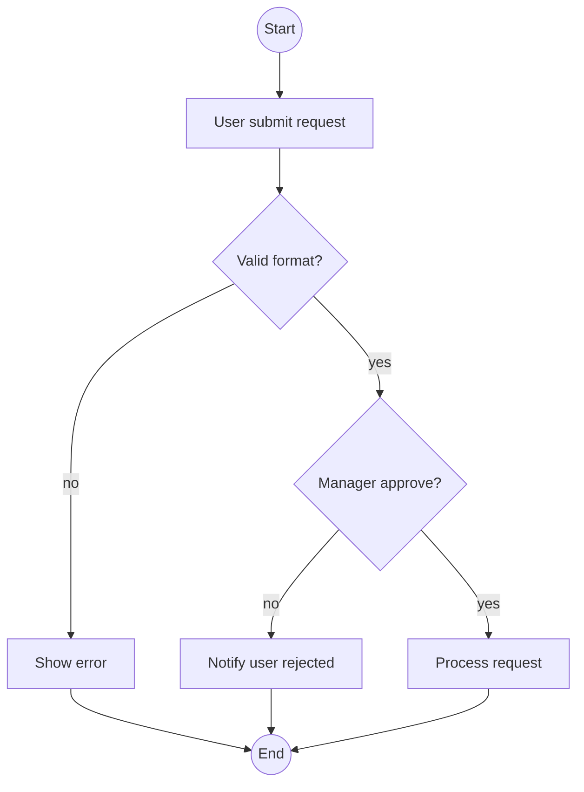

# /activity — Activity / Flowchart Diagram

## Goal

Tạo mermaid `flowchart` cho 1 business process — thể hiện decisions, parallels, sub-processes, loops. Phù hợp khi sequence quá tuyến tính hoặc khi process là business workflow (cùng level abstraction với UC). **Output duy nhất**: append section vào `docs/{feature}/srs/{feature}-flows.md` (cùng file sequence, section riêng).

> **Định vị (per `diagram-selection.md`):** `/activity` (Mermaid) là lựa chọn cho **flow gọn 1-2 vai trò** cần **nhúng inline auto-render** GitHub/Obsidian. Quy trình **đa vai trò nhiều tương tác chéo lane** (refund, duyệt nhiều cấp) → mặc định dùng **`/activity-swimlane`** (PlantUML swimlane thật — Mermaid subgraph xô lệch khi nhiều cross-edge). Nếu phát hiện ≥3 lane với nhiều cross-lane edge, đề xuất user chuyển `/activity-swimlane` ở L1 trước khi vẽ.

## Constraints

- **1 output cố định** — `docs/{feature}/srs/{feature}-flows.md` append mode. KHÔNG flag `--uc`, `--standalone`, `--system-flow`, `--lanes`.
- **L1 approval** trước Write — prose BA-friendly. BẮT BUỘC dừng chờ xác nhận trước khi ghi file.
- **KHÔNG L3 iterate** — mermaid không render trong chat. User review từ rendered file, muốn sửa thì gọi lại skill và nói cần đổi gì.
- **Auto-detect lanes/roles** từ description: scan role keywords (admin, user, system, approver, manager, CSKH). Nếu ≥2 lane → dùng `subgraph` để chia lane. **Nhưng nếu ≥3 lane + nhiều tương tác chéo lane → subgraph Mermaid xô lệch, đề xuất `/activity-swimlane` (PlantUML) ở L1** — user vẫn có quyền chọn ở lại Mermaid nếu cần nhúng inline.
- **Direction tự chọn theo độ phức tạp** — mặc định TB (top-bottom); process nhiều lane/rộng thì tự chuyển LR. User muốn ngang thì nói "vẽ theo chiều ngang" trong câu lệnh hoặc câu trả lời.
- **`--feature` optional** — auto-detect từ ngữ cảnh/feature đang làm dở; mơ hồ mới hỏi bằng picker. **Feature chưa tồn tại + arg là mô tả quy trình → tự derive slug + tạo feature** (điểm-vào, xem `feature-bootstrap.md` nhóm A). KHÔNG bắt qua `/brainstorm` trước.
- **Vietnamese-first** trong labels (mermaid hỗ trợ Unicode); syntax keywords English.
- **flows.md không tồn tại** → tạo mới với frontmatter + heading trần `# {Feature} — Flows` (KHÔNG câu intro/blockquote meta), rồi section `## Flow:` đầu.

## Cách gọi (Inputs)

```
/activity "<description>" --feature <slug>       # append section vào flows.md
/activity "<description>"                          # feature auto-detect từ ngữ cảnh, mơ hồ mới hỏi
/activity "<mô tả quy trình của feature mới>"       # feature chưa có → derive slug + phỏng vấn + tạo feature (nhóm A)
```

Muốn ngang thay vì mặc định top-bottom → nói "vẽ theo chiều ngang". Đã có section cho process đó → gọi lại skill với mô tả thay đổi, skill tự vào update mode (match slug) + L2 diff.

## Context (dynamic)

- Ngày làm việc hiện tại
- Features có sẵn trong `docs/`
- Features có flows.md: kiểm tra `docs/*/srs/*-flows.md`

## Approach

1. **Resolve feature + process slug** — process slug auto-derive từ description (verb-object kebab-case, max 40 chars).
   - Feature chưa tồn tại: tự derive slug, confirm ở L1, tạo thư mục khi Write.
   - Nguồn nghiệp vụ: đọc UC/SRS nếu có; nếu thiếu hỏi gom 1 batch nghiệp vụ: các bước tuần tự, điểm quyết định (câu hỏi + nhánh yes/no), lanes, loops.
2. **Validate target** `docs/{feature}/srs/{feature}-flows.md`:
   - Trùng slug → update mode (L2 diff).
   - Slug mới → append section `## Flow: {title} (Activity)`.
   - Thiếu → tạo mới với slim frontmatter + heading `# {Feature title} — Flows`.
3. **Auto-detect lanes/roles** từ description.
3.5. **Xác nhận lanes trước khi generate (BẮT BUỘC nếu ≥1 lane detect được)**: Xác nhận với người dùng danh sách vai trò phát hiện được để tránh bỏ sót actor ẩn.
4. **Identify decisions + parallels** từ description.
4.5. **Trích fact-list (checklist coverage)**:
   - Lanes/roles đã xác nhận.
   - Decision points: mỗi điểm quyết định + các nhánh.
   - Loose ends check: mọi node phải có ít nhất 1 đường ra dẫn tới 1 end node — không có nhánh cụt.
5. **Generate mermaid flowchart:**
   - `flowchart TB` (default) hoặc `LR`.
   - Node shapes: `[]` rectangle (process), `{}` diamond (decision), `(())` circle (start/end), `[/...\]` parallelogram (input/output).
   - Subgraph cho lanes nếu có ≥2 role.
   - Edge labels cho decision branches: `-->|yes|`, `-->|no|`.
6. **L1 plan preview (BẮT BUỘC DỪNG XÁC NHẬN)**: In bảng kế hoạch và đợi phản hồi của người dùng trước khi ghi file.
7. **Write** — Read flows.md, append section sau last `## Flow:`. Format:
   ```markdown
   ## Flow: {Title} (Activity)
   **Trigger**: {1-line}
   **Related UC**: [[../usecases/uc-{slug}.md]] (nếu detect được, else "TBD")
   **Related FR**: FR-{feature}-NNN, ...
   **Related E**: E-{feature}-NNN, ... (error path trong flow, else "—")

   ```mermaid
   flowchart TB
     ...
   ```
   ```
8. **Update mode tự động** nếu slug đã có.
9. **Activity log** — ghi chú changelog và cập nhật `updated: {date}`.
9.5. **Render-verify (BẮT BUỘC, chạy ngay sau Write)** — kiểm tra cú pháp bằng script:
   `node .agents/skills/_shared/mermaid-verify.mjs --file docs/{feature}/srs/{feature}-flows.md`
   Tự sửa tối đa 2 lần nếu fail cú pháp.
9.6. **Coverage-verify (BẮT BUỘC, đối chiếu fact-list)**:
   - Decision coverage: Mọi decision point có trong fact-list có đủ các nhánh không.
   - Lane coverage: Mọi lane có xuất hiện thành subgraph không.
   - No loose ends: Mọi node có đường ra tới node kết thúc không (không có nhánh cụt).
9.7. **Tiêu chí tự review diagram (Diagram_Reviewer checklist)**
   Khi quy trình có ≥3 lanes HOẶC ≥5 decision points HOẶC nesting decision ≥2 tầng HOẶC loop/retry:
   *Kiểm tra nghiêm ngặt theo các tiêu chí chất lượng:*
   - **BLOCKING:**
     - Thiếu lane/vai trò đã nêu trong fact-list.
     - Dead-end: Một nhánh không dẫn tới node kết thúc nào.
     - Gateway chỉ có 1 outgoing edge.
   - **WARNING:**
     - Nhánh có nhãn mơ hồ ("lỗi khác" không nói rõ lỗi gì).
     - Gateway có nhánh không khớp yêu cầu ban đầu.
10. **Output report:**
    ```
    ✅ Activity diagram appended: docs/{feature}/srs/{feature}-flows.md → ## Flow: {title} (Activity)
       Decisions: {N} | Lanes: {M} | Direction: {TB|LR} | Mermaid compile: OK | Coverage: {N}/{N} decisions, {M}/{M} lanes, no loose ends
    ```

## Mermaid syntax reference



## References

- Rules: `.agents/rules/ba-conventions.md`, `.agents/rules/approval-gate.md`, `.agents/rules/diagram-selection.md`, `.agents/rules/naming-conventions.md`.
- Verifier: `.agents/skills/_shared/mermaid-verify.mjs`.
