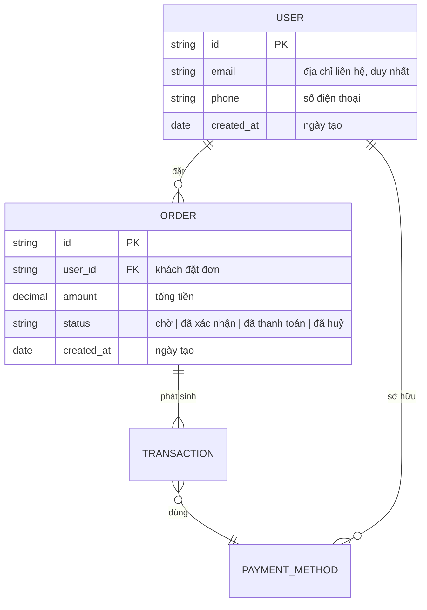

# /erd — Mermaid Entity-Relationship Diagram

## Goal

Tạo Mermaid `erDiagram` cho data model per-feature. **Output duy nhất**: `docs/{feature}/srs/{feature}-erd.md`.

## Constraints

- **1 output cố định** — `docs/{feature}/srs/{feature}-erd.md`.
- **KHÔNG L3 iterate** — mermaid không render trong chat. Đi thẳng L1 plan → Write. User review rendered ERD từ file (IDE/Obsidian/GitHub) → muốn sửa thì gọi lại skill và nói cần đổi gì.
- **L1 approval trước Write**: BẮT BUỘC in bảng kế hoạch các entity/relationship và dừng chờ người dùng phê duyệt trước khi ghi file.
- **`--feature` optional** — auto-detect từ ngữ cảnh/feature đang làm dở; mơ hồ mới hỏi bằng picker.
- **File đã tồn tại** → tự động chuyển sang update mode (L2 diff).
- **Auto-detect entities** từ SRS Mục 6 nếu có.
- **Vietnamese-first** trong description; mermaid keywords English.

## Cách gọi (Inputs)

```
/erd --feature <slug>                         # tạo mới, hoặc tự vào update mode nếu erd.md đã tồn tại
/erd                                          # feature auto-detect từ ngữ cảnh, mơ hồ mới hỏi
/erd "<mô tả data model của feature mới>"     # feature chưa có → derive slug + phỏng vấn + tạo feature
```

## Context (dynamic)

- Ngày làm việc hiện tại
- Features có SRS: kiểm tra `docs/*/srs/*-spec.md`
- Features có ERD: kiểm tra `docs/*/srs/*-erd.md`

## Approach

1. **Resolve feature**: `--feature` nếu có; hoặc auto-detect/prompt.
2. **Validate existing**: `erd.md` đã có → tự vào update mode (L2 diff).
3. **Auto-detect upstream entities**: Scan `docs/{feature}/srs/{feature}-spec.md` Mục 6 Data Entities.
4. **Phỏng vấn đúng phạm vi**: Hỏi gom 1 batch nghiệp vụ: các entity chính, attribute nghiệp vụ của từng entity, quan hệ giữa các entity (1:1, 1:N, N:N). KHÔNG hỏi kiểu DB (varchar/int) — skill tự gán kiểu kỹ thuật gọn (`string`, `int`, `decimal`, `date`, `boolean`).
5. **Generate Mermaid `erDiagram`**:
   - Tên entity viết hoa (UPPERCASE).
   - Attributes dạng `type name [PK|FK] "chú thích nghiệp vụ"`.
   - Relationships: `||--o{` (1:N), `||--||` (1:1), `}o--o{` (N:N).
6. **L1 plan preview (BẮT BUỘC DỪNG XÁC NHẬN)**: Tóm tắt số lượng entity, quan hệ và chờ người dùng duyệt.
7. **Write**: Ghi file `docs/{feature}/srs/{feature}-erd.md`.
8. **Update mode**: L2 diff nếu file đã có.
9. **Render-verify (BẮT BUỘC, chạy ngay sau Write)**:
   `node .agents/skills/_shared/mermaid-verify.mjs --file docs/{feature}/srs/{feature}-erd.md`
   Tự sửa tối đa 2 lần nếu compile fail.
10. **Output report**: Báo cáo số entity, quan hệ và đường dẫn file đã tạo.

## Mermaid syntax reference



## Gotchas

- **2-token format**: Mermaid `erDiagram` bắt buộc mỗi thuộc tính có đúng 2 token `type name` (`string id PK`, không được bỏ `type`).
- **Cardinality syntax**: `LEFT ||--o{ RIGHT` là 1 LEFT có nhiều RIGHT.
- **Inheritance**: Mermaid không có cú pháp kế thừa trực tiếp, biểu diễn thông qua FK + chú thích "ISA relationship".

## References

- Rules: `.agents/rules/ba-conventions.md`, `.agents/rules/approval-gate.md`, `.agents/rules/diagram-selection.md`.
- Verifier: `.agents/skills/_shared/mermaid-verify.mjs`.
- Examples: `references/example-erd.md`.
