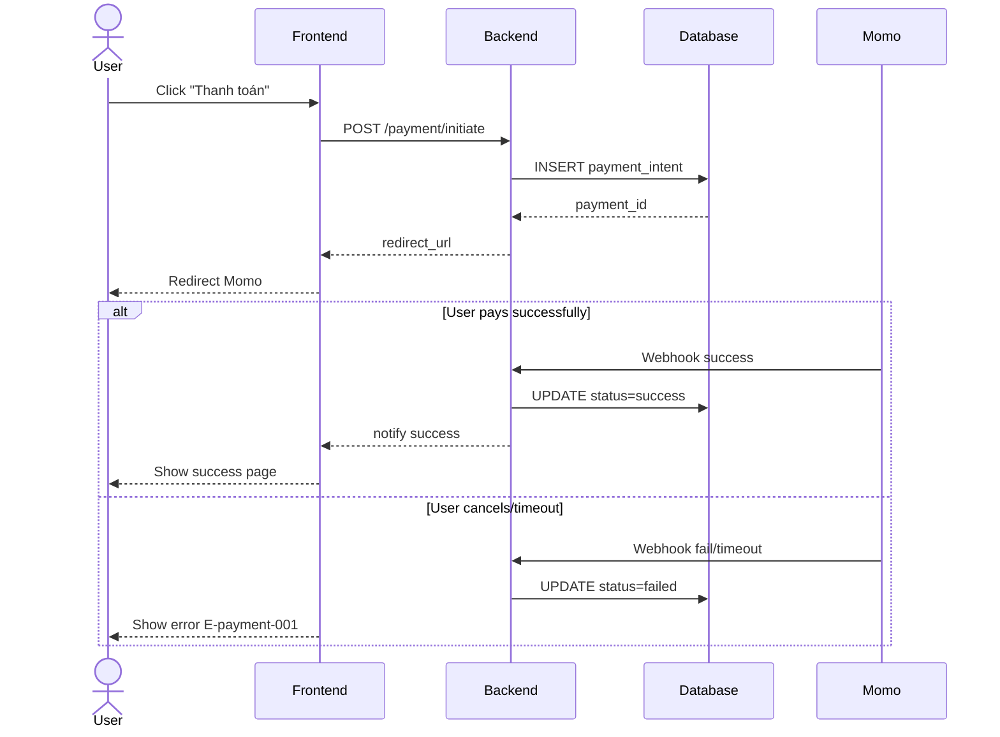

# /sequence — Mermaid Sequence Diagram Generator

## Goal

Tạo Mermaid `sequenceDiagram` block cho 1 flow trong 1 feature. **Output duy nhất**: append section vào `docs/{feature}/srs/{feature}-flows.md`. UC files KHÔNG nhận diagram (UC là business black-box).

## Constraints

- **1 output cố định** — `docs/{feature}/srs/{feature}-flows.md` append mode. KHÔNG flag `--uc`, `--standalone`, `--system-flow`. Quá nhiều flow → user split manually.
- **KHÔNG L3 iterate** — mermaid không render được trong chat. Đi thẳng L1 plan → Write. User review rendered diagram từ file (IDE/Obsidian/GitHub) → muốn sửa thì gọi lại skill và nói cần đổi gì (skill tự vào update mode + L2 diff).
- **L1 approval** trước Write.
- **`--feature` optional** — auto-detect nếu chỉ 1 feature in-progress; mơ hồ mới hỏi. **Feature chưa tồn tại + arg là mô tả flow → tự derive slug + tạo feature** (điểm-vào, xem `feature-bootstrap.md` nhóm A). KHÔNG bắt qua `/brainstorm` trước.
- **Auto-detect actors** từ description prose.
- **Mermaid syntax strict** — matched `participant`/`actor`, balanced `alt`/`end`.
- **Vietnamese-first** trong description/notes; mermaid syntax keywords giữ English.
- **flows.md không tồn tại** → tạo mới với frontmatter + heading trần `# {Feature} — Flows` (KHÔNG câu intro/blockquote meta), rồi section `## Flow:` đầu.

## Cách gọi (Inputs)

```
/sequence "<description>" --feature <slug>       # append section vào flows.md
/sequence "<description>"                         # feature auto-detect từ ngữ cảnh, mơ hồ mới hỏi
/sequence "<mô tả flow của feature mới>"          # feature chưa có → derive slug + phỏng vấn + tạo feature (nhóm A)
```

Muốn dùng nguồn khác thay vì gõ mô tả trực tiếp → tag `@file` hoặc dán nội dung trong câu chat. Đã có section cho flow đó → gọi lại skill với mô tả thay đổi, skill tự vào update mode (match theo slug) + L2 diff.

## Context (dynamic)

- Ngày làm việc hiện tại
- Features có flows.md: tìm kiếm `docs/*/srs/*-flows.md`
- In-progress features: các file `docs/*/srs/*-spec.md` có `status: draft` hoặc `status: in-review`

## Approach

1. **Parse args.** Description bắt buộc (inline string, tag `@file`, hoặc dán nội dung trong câu chat).
2. **Resolve feature.** `--feature` explicit nếu có; else auto-detect (single in-progress) hoặc prompt.
   - **Feature chưa tồn tại (điểm-vào, per `feature-bootstrap.md` nhóm A):** nếu arg là 1 mô tả flow thô mà chưa có `docs/{feature}/` nào khớp (vd `/sequence "khách đặt hàng, hệ thống gọi cổng thanh toán rồi gửi email xác nhận"`) → `/sequence` ĐƯỢC PHÉP tự khởi tạo: derive feature slug từ mô tả (kebab-case, ASCII, ≤50 ký tự), confirm slug ở L1 (user override được), tạo `docs/{feature}/srs/` khi Write. KHÔNG bắt user chạy `/brainstorm` trước.
   - **Nguồn nghiệp vụ:** feature đã có UC/SRS/flows → đọc để lấy actors/steps, không hỏi lại cái đã có (no-re-ask). **Feature mới (hoặc cũ thiếu nguồn)** → **phỏng vấn ĐÚNG PHẠM VI sequence cần** (per `feature-bootstrap.md` nhóm A bước 3), hỏi gom 1 batch business-language (KHÔNG hỏi DB/SDK): **actors** nào tham gia · **thứ tự message** giữa họ (ai gọi ai, response gì) · **nhánh error** (alt/opt — success path vs error/timeout/cancel). KHÔNG bịa — thiếu ý nào hỏi ý đó. Làm rõ đủ để vẽ đúng, không lan man toàn diện như `/brainstorm`.
   - **Mô tả mơ hồ dù feature đã có nguồn** (vd description quá ngắn, không nói rõ actors/nhánh error, hoặc UC/SRS đọc được cũng thiếu chi tiết) → **PHẢI hỏi clarifying trước khi generate**, KHÔNG tự suy đoán và generate luôn. Câu hỏi tối thiểu: "Actors nào tham gia?", "Có nhánh lỗi/timeout/hủy nào cần thể hiện?". Đây không phải bootstrap phỏng vấn (feature đã có) — chỉ là 1-2 câu hỏi ngắn bù chỗ thiếu, không lặp lại no-re-ask.
2.5. **Trích fact-list (checklist coverage)** — TRƯỚC khi generate, liệt kê ngắn gọn (không cần file riêng, giữ trong context):
   - **Actors**: mọi actor sẽ xuất hiện làm participant/actor trong diagram.
   - **Main flow steps**: các bước theo thứ tự (tương ứng message chính).
   - **Alternative/Error Flows**, đánh ID con kiểu `A1`, `A1.1`, `A1.2` (theo mẫu prompt BA chuẩn) — mỗi nhánh error/alt/timeout/cancel 1 ID riêng, KHÔNG gộp chung "có nhánh error" mơ hồ. Nếu mô tả/UC chỉ nói chung chung "có xử lý lỗi" mà không rõ lỗi gì → hỏi lại (xem bước 2 trên), đừng tự bịa case cụ thể.
   Fact-list này dùng làm checklist đối chiếu ở bước 9.6.
3. **Derive flow slug** từ description (verb-object kebab-case, max 40 chars).
4. **Validate target** `docs/{feature}/srs/{feature}-flows.md`:
   - Tồn tại + trùng slug → tự vào update mode (L2 diff cho section đó).
   - Tồn tại, slug mới → **KHÔNG append mù**. Liệt kê các section `## Flow:` gần khớp cho user chọn sửa hoặc append mới.
   - Thiếu → tạo mới: slim frontmatter (`type: srs-flows`, `feature`, `updated`) + heading trần `# {Feature title} — Flows`, rồi append thẳng section `## Flow:` đầu tiên. KHÔNG chèn câu intro/blockquote mô tả meta-text.
5. **Auto-detect actors** từ description: scan capitalized nouns + common roles (User, FE/Client, BE/Backend, DB, third-party như Stripe/Momo). Tên người → generalize "User".
6. **Generate Mermaid `sequenceDiagram`:**
   - `actor User` cho human, `participant X as Y` cho system.
   - Mỗi step → 1 message arrow: `->>` = request/gọi (nét liền), `-->>` = kết quả/response (nét đứt) — đây là quy ước team.
   - Error/conditional branches → `alt ... else ... end` (2+ nhánh loại trừ nhau) hoặc `opt ... end` (1 đoạn có-thể-xảy-ra, không else).
   - `par ... and ... end` khi chạy song song thật sự; `loop ... end` khi lặp/polling/retry.
   - `autonumber`: optional, chỉ bật khi doc đi kèm narrate lại theo số bước.
   - `Note over`/`Note right of`: cho business rule / SLA / giả định / tham chiếu FR-BR-E.
   - KHÔNG dùng `ref` trong diagram Mermaid; liên kết flow bằng metadata Markdown "Related flows".
   - Flow quá phức tạp (>15 step, hoặc >8 participant, hoặc nesting >2 tầng) → cảnh báo, đề xuất chia nhỏ.
7. **L1 plan preview** — BẮT BUỘC DỪNG XÁC NHẬN: show path + action (append/update) + actors + steps count + related UC. Chờ phản hồi của người dùng trước khi ghi file.
8. **Write** — Read flows.md, append section sau last `## Flow:`. Mỗi section format:
   ```markdown
   ## Flow: {Title}
   **Trigger**: {1-line}
   **Related UC**: [[../usecases/uc-{slug}.md]] (nếu detect được, else "TBD")
   **Related FR**: FR-{feature}-NNN, ...
   **Related E**: E-{feature}-NNN, ... (error path trong flow, else "—")

   ```mermaid
   sequenceDiagram
     ...
   ```
   ```
   > ID full-form bắt buộc: `FR-{feature}-NNN` / `E-{feature}-NNN`.
9. **Activity log** — Cập nhật changelog/activity note và update timestamp `updated: {date}` trong file target.
9.5. **Render-verify (BẮT BUỘC, chạy ngay sau Write)** — chạy lệnh:
   `node .agents/skills/_shared/mermaid-verify.mjs --file docs/{feature}/srs/{feature}-flows.md`
   - **Pass** → tiếp bước 9.6.
   - **Fail** → đọc thông báo lỗi, tự sửa section vừa tạo (tối đa 2 lần). Nếu vẫn fail sau 2 lần, báo rõ cho người dùng.
9.6. **Coverage-verify (BẮT BUỘC, tự đối chiếu fact-list)** — đối chiếu với fact-list ở bước 2.5 theo 3 chiều:
   1. **Actor**: Mọi actor có mặt làm `participant`/`actor` không?
   2. **Main flow steps**: Từng bước chính có message tương ứng không?
   3. **Alternative/Error Flow**: Từng nhánh A1, A1.1... có khối `alt`/`opt` với label điều kiện chính xác không?
   - Thiếu → tự bổ sung và verify lại 9.5.
9.7. **Tiêu chí tự review diagram (Diagram_Reviewer checklist)**
   Khi diagram đạt độ phức tạp: ≥3 alt/error-flows HOẶC ≥4 participants HOẶC nesting alt/opt ≥2 tầng HOẶC có callback/timeout/webhook:
   *Có thể dùng subagent nếu khả dụng, hoặc tự rà soát theo rubric:*
   - **BLOCKING:**
     - Actor có trong fact-list nhưng vắng mặt trong Mermaid code.
     - Alternative/Error Flow có ID (A1, A1.1...) trong fact-list nhưng thiếu khối `alt`/`opt`.
     - Thứ tự message vi phạm logic (response đến trước request).
   - **WARNING:**
     - Nhánh có nhãn quá mơ hồ ("nếu lỗi" mà không nói rõ lỗi gì).
     - Nhánh orphan (nhánh xuất hiện trong Mermaid nhưng không có trong fact-list).
   - **Checklist coverage:**
     - [ ] Actor: {tên} — có mặt
     - [ ] Alt-flow: {ID} — có mặt
10. **Output report:**
    ```
    ✅ Sequence diagram appended: docs/{feature}/srs/{feature}-flows.md → ## Flow: {title}
       Actors: {list} | Steps: {N} | Mermaid compile: OK | Coverage: {N}/{N} actors, {S}/{S} main-steps, {M}/{M} alt-flows
    ```

## Mermaid syntax reference



## Gotchas

- **flows.md header convention** — First run: slim frontmatter + heading trần `# {Feature} — Flows`. Sub-sequent: append sau last `## Flow:`.
- **Description vague** — Hỏi clarifying trước khi vẽ.
- **Diagram quá lớn** — Cảnh báo và gợi ý tách nếu >15 bước hoặc >8 participants.
- **Mũi tên** — `->>` = request, `-->>` = response.
- **Coverage thiếu ≠ lỗi cú pháp** — Compile OK (9.5) không có nghĩa là đã vẽ hết nghiệp vụ (9.6).

## References

- Rules: `.agents/rules/ba-conventions.md`, `.agents/rules/approval-gate.md`, `.agents/rules/diagram-selection.md`, `.agents/rules/naming-conventions.md`.
- Verifier: `.agents/skills/_shared/mermaid-verify.mjs`.
- Examples: `references/example-sequence.md`.
