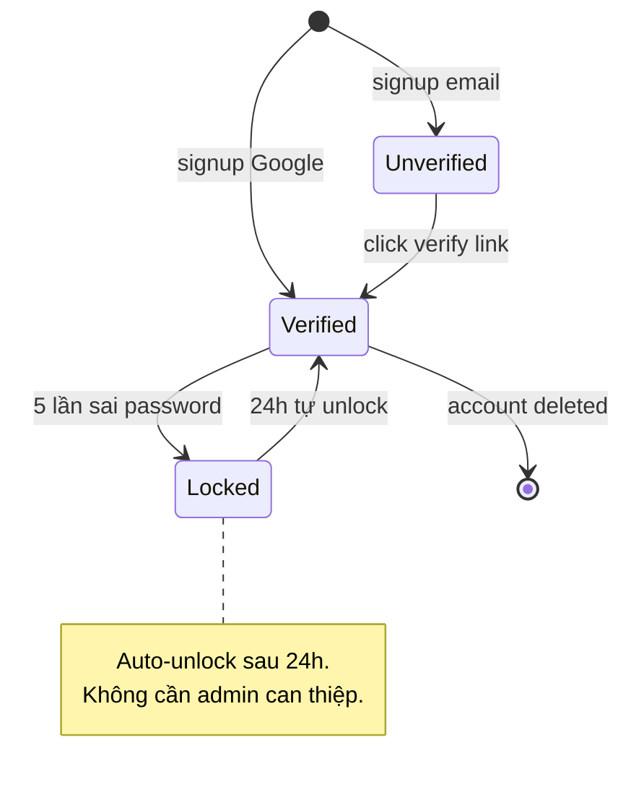

# /state — Per-entity State Diagram

## Goal

Tạo mermaid `stateDiagram-v2` cho 1 entity của feature, capture: states + transitions + triggers + invalid transitions. **Output duy nhất**: append section vào `docs/{feature}/srs/{feature}-states.md` (1 file gộp mọi entity, mỗi entity 1 `## State: <Entity>` section).

## Constraints

- **1 output cố định** — `docs/{feature}/srs/{feature}-states.md` append mode.
- **`--feature` optional** — auto-detect từ ngữ cảnh/feature đang làm dở; mơ hồ mới hỏi bằng picker.
- **L1 approval trước Write**: BẮT BUỘC in kế hoạch các state/transition và dừng chờ người dùng phê duyệt trước khi ghi file.
- **KHÔNG L3 iterate** — mermaid không render trong chat. Review qua rendered file.
- **Invalid transitions explicit** — Bảng riêng trong section liệt kê transitions KHÔNG được phép.
- **Vietnamese-first** trong description/notes; mermaid syntax keywords giữ English.
- **states.md không tồn tại** → tạo mới với header skeleton.

## Cách gọi (Inputs)

```
/state <entity> --feature <slug>       # append section vào states.md
/state <entity>                        # feature auto-detect từ ngữ cảnh, mơ hồ mới hỏi
/state <entity> "<feature mới>"        # feature chưa có → derive slug + phỏng vấn + tạo feature
```

## Context (dynamic)

- Ngày làm việc hiện tại
- Features có sẵn trong `docs/`
- Features có states.md: kiểm tra `docs/*/srs/*-states.md`

## Approach

1. **Resolve feature + entity**: entity viết dạng UpperCamelCase.
2. **Auto-detect existing state info**: Đọc brainstorm hoặc spec Mục 4 Business Rules. Nếu thiếu, hỏi gom 1 batch nghiệp vụ: entity nào, các trạng thái, trigger chuyển trạng thái, transition cấm.
3. **Trích fact-list**: States, Transitions + trigger, Invalid transitions.
4. **Validate states count**: <3 states, cảnh báo xem bảng có đủ không trước khi vẽ.
5. **Generate mermaid stateDiagram-v2**:
   - `[*] --> initial_state` cho điểm bắt đầu.
   - `state --> next_state : trigger / condition`.
   - `final_state --> [*]` cho điểm kết thúc.
6. **L1 plan preview (BẮT BUỘC DỪNG XÁC NHẬN)**: Tóm tắt N states, M transitions, K invalid transitions và chờ người dùng phê duyệt.
7. **Write**: Ghi vào `docs/{feature}/srs/{feature}-states.md`.
8. **Render-verify (BẮT BUỘC, chạy ngay sau Write)**:
   `node .agents/skills/_shared/mermaid-verify.mjs --file docs/{feature}/srs/{feature}-states.md`
   Tự sửa tối đa 2 lần nếu fail cú pháp.
9. **Coverage-verify**: Đối chiếu fact-list đảm bảo không sót state hoặc trigger nào.
10. **Output report**: Báo cáo số state, transition và đường dẫn file đã cập nhật.

## Mermaid syntax reference



## Gotchas

- **Invalid transitions**: KHÔNG vẽ trực tiếp vào diagram (làm rối hình); để ở bảng Markdown riêng phía dưới.
- **Tên entity**: Viết UpperCamelCase (Order, Account, Payment).
- **Mũi tên ngược**: Chú ý kiểm tra chiều chuyển trạng thái để không vẽ ngược luồng logic.

## References

- Rules: `.agents/rules/ba-conventions.md`, `.agents/rules/approval-gate.md`, `.agents/rules/diagram-selection.md`.
- Verifier: `.agents/skills/_shared/mermaid-verify.mjs`.
