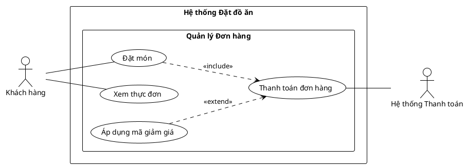

# /usecase-diagram — Use Case Diagram (PlantUML native)

## Goal

Tạo visual use case diagram cho 1 feature: actors (bên ngoài system) + use cases (bên trong system boundary, gom nhóm theo package khi nhiều) + relationships (`include`, `extend`, `generalization`). Phục vụ kickoff stakeholder và system scope overview — KHÔNG phải detail flow (đó là `/usecase` text doc).

Output trong `docs/{feature}/usecases/`:
1. `{feature}-usecase-diagram.puml` — **source** PlantUML do AI viết.
2. `{feature}-usecase-diagram.svg` — render sẵn (mở bằng browser/IDE/Obsidian).
3. Ảnh `.svg` + bảng Actors/Use Cases/Relationships được nhúng vào **`{feature}-usecase-index.md`**.

## Constraints

- **L1 approval trước Write**: BẮT BUỘC hiển thị tóm tắt actor, use case, package boundary và dừng chờ người dùng phê duyệt trước khi ghi file.
- **KHÔNG L3 iterate**: PlantUML không render trong chat. Review qua file `.svg`.
- **`--feature` optional**: Auto-detect từ ngữ cảnh; mơ hồ mới hỏi bằng picker.
- **Render qua script**: Dùng `render.py` (hoặc `render.sh`) trong thư mục skill `.agents/skills/usecase-diagram/`.
- **Compile phải PASS**: Server trả về SVG hợp lệ (>200 bytes, không có syntax error).
- **System boundary BẮT BUỘC**: Mọi use case nằm trong 1 boundary `rectangle "System: {feature}" { ... }`; actor ở ngoài.
- **Relationship phải có evidence + rationale**: Chỉ vẽ `include`/`extend`/`generalization` khi có căn cứ rõ ràng, mặc định actor `--` UC.
- **Vietnamese-first**: Labels tiếng Việt, cú pháp English.

## Cách gọi (Inputs)

```
/usecase-diagram --feature <slug>    # auto-detect actors + use cases; tự vào update mode nếu diagram.puml đã có
/usecase-diagram                     # feature auto-detect từ ngữ cảnh, mơ hồ mới hỏi
```

## Context (dynamic)

- Ngày làm việc hiện tại
- Python/python3 và kết nối internet tới plantuml.com
- Features có sẵn trong `docs/`

## Approach

1. **Resolve feature**: Kiểm tra nguồn `usecases/{feature}-usecase-index.md` hoặc `srs/{feature}-spec.md`. Nếu thiếu cả hai, hướng dẫn người dùng chạy `/usecase` hoặc `/srs` trước.
2. **Validate existing**: Nếu `{feature}-usecase-diagram.puml` đã có → tự chuyển update mode (L2 diff).
3. **Auto-detect actors + use cases**: Đọc file index và spec để tổng hợp danh sách actor và use case.
4. **Phân loại actors**: Primary (người dùng chính), Secondary (hỗ trợ/quản trị), System (hệ thống/dịch vụ ngoài).
5. **Xác định relationships**: `include` (bắt buộc gọi), `extend` (mở rộng theo điều kiện), `generalization` (chuyên biệt hoá).
6. **System boundary & Package**: Định nghĩa boundary hệ thống và các package phân nhóm chức năng.
7. **Viết source `.puml`**:
   - Actor khai báo ngoài boundary.
   - Use case khai báo trong boundary.
   - Nối actor với use case bằng `--`.
8. **L1 plan preview (BẮT BUỘC DỪNG XÁC NHẬN)**:
   > Em sẽ vẽ use case diagram cho {feature} với N actors + M use cases (system boundary + K packages nếu có) + J relationships. Apply? (Y / sửa)
9. **Write & Render**:
   - Ghi file `.puml`.
   - Render: `python .agents/skills/usecase-diagram/render.py docs/{feature}/usecases/{feature}-usecase-diagram.puml` (hoặc `bash ... render.sh ...`).
10. **Ghi ảnh + bảng vào `{feature}-usecase-index.md`**: Section `## Diagram` nhúng `` + section `## Actors` và `## Relationships`.
11. **Output report**: Báo cáo kết quả và đường dẫn file đã tạo.

## PlantUML Syntax Reference



## Gotchas

- **Hướng mũi tên include/extend**:
  - `UC_A ..> UC_B : <<include>>` nghĩa là A luôn gọi B.
  - `UC_Extending ..> UC_Base : <<extend>>` nghĩa là B mở rộng A khi thoả điều kiện (mũi tên trỏ về Base).
- **System boundary**: Không để use case nằm ngoài boundary, không để actor nằm trong boundary.

## References

- Rules: `.agents/rules/ba-conventions.md`, `.agents/rules/approval-gate.md`, `.agents/rules/diagram-selection.md`.
- Engine: `render.py`, `render.sh`, `plantuml_encode.py`.
