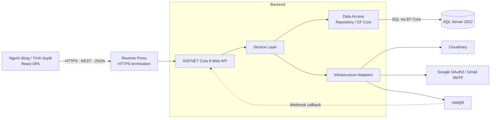
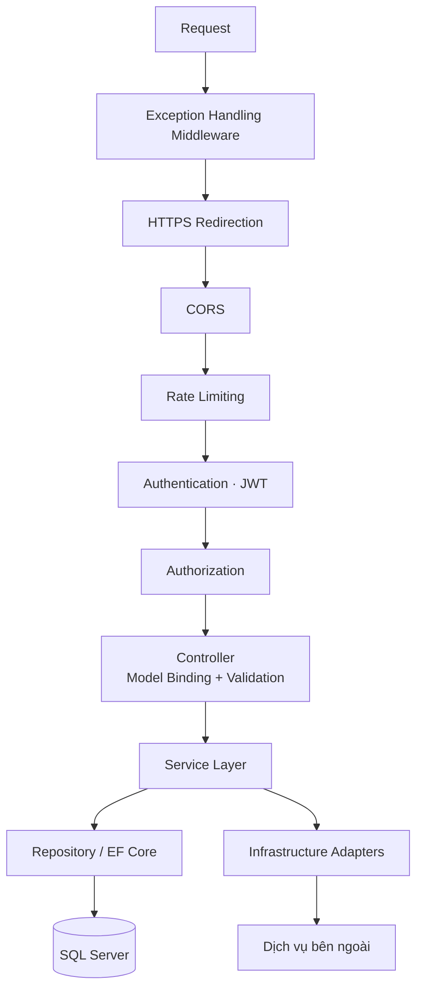
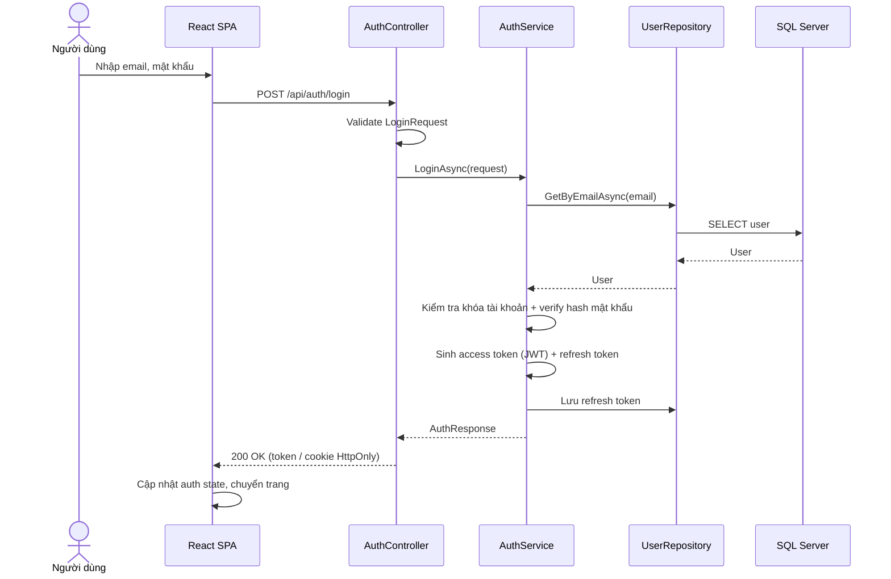
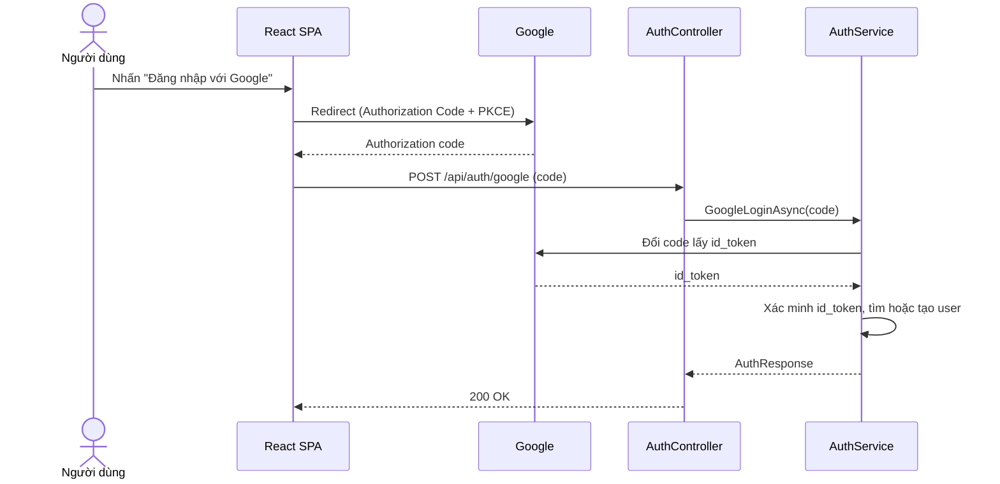

# Tài liệu Kiến trúc Phần mềm (Software Architecture)

| Mục | Nội dung |
|---|---|
| Phiên bản tài liệu | 1.0 |
| Kiểu kiến trúc | Monolith phân lớp (Layered Architecture), mô hình Client–Server |
| Nguồn | Sơ đồ `Software_Architechture.drawio`, đã chỉnh sửa theo các góp ý ở mục 9 |

---

## 1. Tổng quan

Hệ thống gồm một **ứng dụng web SPA** (React) giao tiếp với **Web API** (ASP.NET Core 8) qua HTTPS/REST/JSON. Backend lưu dữ liệu trên **SQL Server** và tích hợp các dịch vụ ngoài: **Cloudinary** (lưu ảnh/minh chứng), **Google** (OAuth2 SSO, Gmail SMTP) và **VietQR** (tạo mã QR / URL thanh toán, nhận webhook xác nhận giao dịch).

### Nguyên tắc thiết kế

- **Separation of Concerns:** mỗi tầng có một trách nhiệm duy nhất.
- **Dependency Inversion:** Service phụ thuộc vào *interface* (repository, adapter), không phụ thuộc implementation cụ thể.
- **Business logic chỉ nằm ở Service Layer**, Controller chỉ điều phối.
- **Controller chỉ làm việc với DTO**, không trả Entity ra ngoài.
- **Bảo mật mặc định:** mọi endpoint yêu cầu xác thực, trừ những endpoint được đánh dấu `[AllowAnonymous]` rõ ràng.

---

## 2. Công nghệ sử dụng

| Thành phần | Công nghệ |
|---|---|
| Frontend | React (19.x), TypeScript, Tailwind CSS, React Router DOM, Axios |
| Backend | ASP.NET Core 8 Web API, C# |
| ORM / Truy cập dữ liệu | Entity Framework Core (có thể bọc Repository) |
| Cơ sở dữ liệu | SQL Server 2022 |
| Xác thực | JWT (access token + refresh token), Google OAuth2 |
| Lưu trữ tệp | Cloudinary |
| Email | Gmail SMTP |
| Thanh toán | VietQR (mã QR / Payment URL + Webhook) |

> Cần kiểm tra lại số phiên bản chính xác của React trong `package.json` trước khi ghi vào tài liệu chính thức.

---

## 3. Kiến trúc tổng thể



---

## 4. Frontend (React SPA)

SPA chạy trên trình duyệt người dùng; server chỉ phục vụ file tĩnh (build output).

| Thành phần | Trách nhiệm |
|---|---|
| **Pages** | Màn hình ứng với từng route |
| **Layouts** | Khung giao diện dùng chung (header, sidebar, footer) |
| **Components / UI** | Thành phần giao diện tái sử dụng |
| **React Router DOM** | Định tuyến, route guard (chặn truy cập khi chưa đăng nhập hoặc thiếu quyền) |
| **State Management** | Quản lý trạng thái toàn cục (ví dụ trạng thái đăng nhập, thông tin user) |
| **Custom Hooks / Utils** | Logic dùng lại, hàm tiện ích |
| **API Services (Axios)** | Gọi backend; interceptor tự gắn token và xử lý refresh khi nhận `401` |

### Cấu trúc thư mục đề xuất

```
src/
├── api/            # Axios instance, interceptors, các service gọi API
├── components/     # UI dùng chung
├── layouts/
├── pages/
├── routes/         # Cấu hình router, ProtectedRoute
├── store/          # State management (auth, ...)
├── hooks/
├── utils/
└── types/          # Kiểu TypeScript (khớp với DTO backend)
```

---

## 5. Backend (ASP.NET Core 8 Web API)

### 5.1 Pipeline xử lý một request

Middleware chạy **trước** Controller. Thứ tự đăng ký trong `Program.cs` đề xuất:



### 5.2 Các tầng

| Tầng | Trách nhiệm | Không được làm |
|---|---|---|
| **Middleware** | Xử lý lỗi toàn cục, CORS, rate limit, xác thực JWT, phân quyền, logging | Chứa business logic |
| **Controller (API Endpoints)** | Nhận request, validate DTO (DataAnnotations / FluentValidation), gọi Service, trả response chuẩn | Truy cập DB trực tiếp, chứa business logic |
| **Service (Business Logic)** | Quy tắc nghiệp vụ, điều phối repository và adapter, quản lý transaction | Phụ thuộc vào HTTP context |
| **Data Access (Repository)** | Truy vấn và cập nhật dữ liệu qua EF Core, ánh xạ Entity | Chứa nghiệp vụ |
| **Infrastructure Adapters** | Đóng gói giao tiếp với dịch vụ ngoài sau các interface | Bị Service gọi trực tiếp bằng implementation cụ thể |
| **Domain / Models** | **Entities** (ánh xạ DB) tách riêng với **DTOs** (hợp đồng API) | Để Entity lộ ra response |

> `DbContext` của EF Core vốn đã đóng vai trò Repository và Unit of Work. Chỉ nên bọc thêm lớp Repository khi cần để dễ kiểm thử hoặc tách các truy vấn phức tạp.

### 5.3 Cấu trúc thư mục đề xuất

```
Backend/
├── Controllers/
├── Middlewares/
├── Services/
│   ├── Interfaces/
│   └── Implementations/
├── Repositories/
│   ├── Interfaces/
│   └── Implementations/
├── Infrastructure/
│   ├── Cloudinary/
│   ├── Google/        # OAuth2 + Mail
│   └── Payment/
├── Domain/
│   └── Entities/
├── DTOs/
│   ├── Requests/
│   └── Responses/
├── Validators/
├── Data/              # DbContext, Migrations, Configurations
└── Program.cs
```

---

## 6. Tích hợp dịch vụ bên ngoài

| Dịch vụ | Mục đích | Hướng gọi | Lưu ý |
|---|---|---|---|
| **Cloudinary** | Upload ảnh / minh chứng | Backend → Cloudinary | Giới hạn dung lượng và định dạng; lưu `public_id` và URL vào DB |
| **Google OAuth2** | Đăng nhập SSO | Trình duyệt ↔ Google ↔ Backend | Backend xác minh `id_token`; không tin dữ liệu user do frontend gửi |
| **Gmail SMTP** | Gửi email (xác thực, quên mật khẩu) | Backend → SMTP | Nên gửi bất đồng bộ (background job / queue) |
| **VietQR** | Tạo mã QR / URL thanh toán | Backend → VietQR | Lưu mã giao dịch và trạng thái |
| **VietQR Webhook (callback)** | Nhận kết quả thanh toán | **VietQR → Backend** | Là một **Controller công khai riêng**, bắt buộc xác minh chữ ký, xử lý idempotent, không dùng JWT |

---

## 7. Luồng nghiệp vụ tiêu biểu: Đăng nhập

### 7.1 Đăng nhập bằng tài khoản / mật khẩu



### 7.2 Đăng nhập bằng Google



### 7.3 Yêu cầu bảo mật cho chức năng Login

- Endpoint login và đăng ký dùng `[AllowAnonymous]`; JWT middleware chỉ bảo vệ các endpoint còn lại.
- Băm mật khẩu bằng thuật toán chuẩn (ASP.NET Core Identity, BCrypt hoặc Argon2), không tự cài đặt.
- Access token có thời hạn ngắn; refresh token lưu DB, có xoay vòng (rotation) và thu hồi được.
- Ưu tiên lưu token trong cookie `HttpOnly`, `Secure`, `SameSite` thay vì `localStorage`.
- Rate limiting và khóa tài khoản tạm thời khi sai nhiều lần.
- Thông báo lỗi chung chung, không tiết lộ email có tồn tại hay không.
- Ghi log các sự kiện đăng nhập thất bại.

---

## 8. Yêu cầu phi chức năng

| Hạng mục | Đề xuất |
|---|---|
| **Bảo mật** | HTTPS bắt buộc, CORS chỉ cho phép origin của frontend, kiểm tra đầu vào, bí mật (connection string, API key) lưu trong biến môi trường hoặc secret manager |
| **Xử lý lỗi** | Middleware xử lý lỗi toàn cục, trả lỗi theo chuẩn `ProblemDetails` (RFC 7807) |
| **Logging / Monitoring** | Ghi log có cấu trúc (Serilog), correlation id cho mỗi request, health check endpoint |
| **Hiệu năng** | Phân trang các API danh sách, index DB hợp lý, cân nhắc cache cho dữ liệu ít thay đổi |
| **Khả năng mở rộng** | Backend stateless nên có thể scale ngang; tác vụ chậm (gửi mail, xử lý webhook) chuyển sang background job |
| **Kiểm thử** | Unit test cho Service (mock repository và adapter), integration test cho API và DB |
| **Triển khai** | Frontend build tĩnh phục vụ qua web server hoặc CDN; backend chạy sau reverse proxy (Nginx/IIS); CI/CD tự động build và test |

---

## 9. Các điều chỉnh so với sơ đồ gốc

| # | Vấn đề ở sơ đồ gốc | Điều chỉnh trong tài liệu này |
|---|---|---|
| 1 | Controller được vẽ trước Middleware | Middleware chạy trước Controller (mục 5.1) |
| 2 | Request Validation là một tầng riêng sau Middleware | Validation thuộc model binding / filter tại Controller |
| 3 | Hai đường Controller → Service (có đường bỏ qua validation) | Chỉ còn một luồng duy nhất |
| 4 | Domain/Models gộp "Entities + DTOs" | Tách Entities và DTOs |
| 5 | Webhook thanh toán vẽ qua Infrastructure, mũi tên hai chiều | Webhook vào Controller công khai riêng, có xác minh chữ ký |
| 6 | Đặt tên lẫn lộn VietQR / VNPay (id `vnpay`, nhãn "IPN") | Thống nhất dùng **VietQR**; đổi id/nhãn trong file drawio tương ứng (`vnpay` → `vietqr`, "IPN webhook" → "webhook callback") |
| 7 | Google OAuth2 và Gmail SMTP gộp một khối | Tách thành hai adapter riêng |
| 8 | Hai khung Front-end chồng nhau, luồng Internet chưa nhất quán | SPA chạy ở trình duyệt, gọi API qua HTTPS |
| 9 | Thiếu reverse proxy, CORS, logging, rate limiting, background job | Bổ sung ở mục 3, 5 và 8 |
| 10 | Service phụ thuộc trực tiếp vào implementation | Phụ thuộc interface (Dependency Inversion) |

---

## 10. Việc cần xác nhận thêm

- Phiên bản thực tế của các thư viện (đặc biệt React).
- Lựa chọn thư viện State Management (Context, Redux Toolkit, Zustand, ...).
- Có dùng **ASP.NET Core Identity** hay tự quản lý bảng user.
- Môi trường triển khai (on-premise, Azure, VPS, container).
